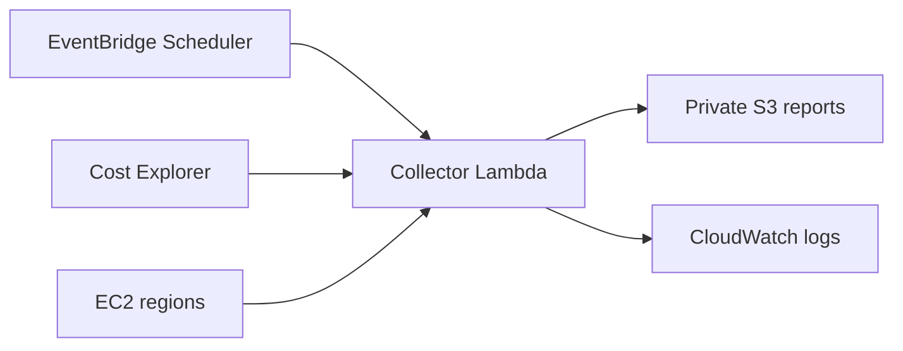

# CloudThrift

**Monitor Smarter. Spend Less. Automate Everything.**

CloudThrift is a serverless AWS FinOps portfolio project. Phase 1 collects account-visible Cost Explorer spending and an explicitly configured set of regional EC2 inventories into private, versioned S3 reports. It is implemented locally; deployment and real-data verification have not been performed.



The application uses Python 3.12, Boto3, Terraform, S3, Lambda, EventBridge Scheduler, IAM and CloudWatch Logs. The collector cannot alter EC2 resources. GitHub Actions validates changes; the workflows do not deploy.

## Status and scope

Implemented: daily service-grouped unblended costs, daily and month-to-date totals through the previous UTC day, multi-region EC2 inventory, partial-failure reporting, a deterministic scheduler report key, and Phase 1 Terraform. Cost Explorer may return estimated and delayed data. Its scope depends on the caller's billing permissions: a management account may see organization data. EC2 inventory is in the caller account and only configured regions. Tags are included in reports and can contain sensitive values; restrict bucket access.

Planned, not implemented: waste detection, EBS inventory, savings, remediation and approvals, Budgets, SNS, DynamoDB, metrics, Grafana, AWS deployment workflows and OIDC. Grafana is not available yet. See [progress](docs/implementation-progress.md).

## Local development

On Windows with the Python launcher:

```powershell
py -3.12 -m pip install -e '.[dev]'
py -3.12 -m ruff check .
py -3.12 -m ruff format --check .
py -3.12 -m pytest -q
py -3.12 scripts/package_lambda.py
terraform fmt -check -recursive terraform
terraform -chdir=terraform/bootstrap init -backend=false
terraform -chdir=terraform/bootstrap validate
terraform -chdir=terraform/environments/dev init -backend=false
terraform -chdir=terraform/environments/dev validate
```

Tests mock AWS and need no credentials. The source-only ZIP has normalized file ordering and timestamps; Lambda supplies Boto3 and botocore, so runtime SDK updates are outside this repository's control. Use IAM Identity Center or other temporary credentials for AWS operations.

See [deployment and cleanup](docs/deployment.md), [architecture and schema](architecture/architecture.md), [security](docs/security.md), and [cost assumptions](docs/cost-estimation.md). Review before seeking explicit approval to deploy. AWS Budgets, even if added later, does not prevent charges.

## Repository

`src/cloudthrift` contains collectors, reporting and a handler; `terraform` holds bootstrap, environment and reusable modules; `tests` contains mocked tests; `scripts` packages Lambda; `.github/workflows` validates changes. `build/` and Terraform state are ignored.
